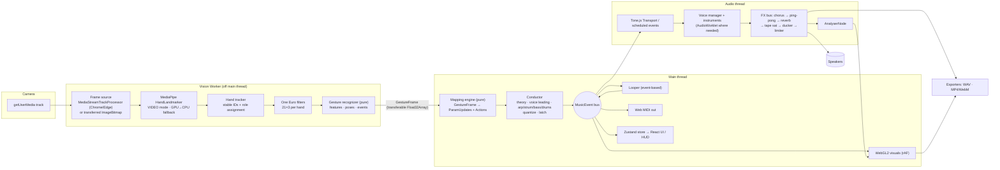

# HANDWAVE — Plan

> Working name lives in one constant: `src/config/app.ts → APP_NAME`.
> Everything here is an original design. No code, branding, or assets are taken from other projects.

This document covers the architecture, the module interfaces (TypeScript), the threading and timing
model, how each quality bar gets tested, and a phased roadmap. **No code gets written until you approve it.**

---

## 1. Design principles

1. **Hands are noisy. Music must not be.** Every signal goes through filtering and hysteresis before
   it can change the music. Audio runs constantly; the hands only steer it. Oscillators are never
   restarted on a chord change. Notes glide or crossfade.
2. **One event stream.** Every musical action (note on/off, chord change, param automation) is a
   typed `MusicEvent` on one bus. The synth, looper, MIDI out, visuals, and game scorer all
   subscribe to it. This makes looping, MIDI, and exact offline re-rendering (WAV and stems) cheap.
3. **Pure core, thin shell.** `gestures/`, `mapping/`, `theory/`, and the scheduling logic in
   `performance/` are pure, deterministic functions (state in, state out). They are tested in Vitest
   without a browser. Browser APIs stay at the edges.
4. **Audio clock is the only clock for sound.** Gesture frames come in at about 30–60 Hz. Each one
   is turned into events with an audio-clock timestamp (`ctx.currentTime + lookahead`, or snapped to
   a grid), and those are scheduled ahead of time. Nothing audible fires from rAF or a message handler.
5. **Privacy by construction.** No network calls at runtime: models, WASM, and impulse responses are
   bundled or generated. A CSP with `connect-src 'self'` enforces it. The UI says so clearly.

---

## 2. Architecture

### 2.1 Threads and data flow



**Why gesture recognition runs in the worker too:** it is pure and cheap, and doing it there means
the main thread only receives about 1 KB of features per frame instead of raw landmarks. The
main-thread budget per vision frame is then: one `postMessage` receive, the mapping evaluation, and
scheduling. Target < 1 ms, far under the 8 ms bar. The debug overlay still gets the filtered
landmarks for drawing.

**Frame source tiers** (picked by feature detection at startup):

| Tier | Browsers | How frames reach the worker | Main-thread cost |
|---|---|---|---|
| A | Chrome, Edge | `MediaStreamTrack` transferred to worker → `MediaStreamTrackProcessor` → `VideoFrame` | ~0 |
| B | Safari 17+, Firefox | `requestVideoFrameCallback` → `createImageBitmap(video)` → transfer | ~0.3–1 ms |
| C | Old / weak devices | Tier B at reduced resolution and rate (e.g. 320×240 @ 20 fps) | lower |

GPU delegate inside a worker needs `OffscreenCanvas` + WebGL2. If initialization fails, fall back to
the CPU delegate (XNNPACK/WASM SIMD) and show it in the debug panel.

### 2.2 Timing and latency model

```
t0  camera capture          (VideoFrame.timestamp / rVFC metadata.captureTime when available)
t1  worker receives frame
t2  landmarks ready         (detect done)
t3  GestureFrame on main
t4  event scheduled at      audio time T = ctx.currentTime + LOOKAHEAD (≈ 5–10 ms) or next grid slot
t5  sound leaves DAC        T + ctx.outputLatency (+ baseLatency)
```

* The debug panel shows each stage (rolling p50/p95) and the **measured end-to-end** `t5 − t0`.
* The Tone context is created with `latencyHint: 'interactive'` and `lookAhead ≈ 0.01`. Tone's
  default of 0.1 s would blow the latency budget.
* **Honest caveat:** the time between light hitting the sensor and `t0` is set by the camera driver
  and can't be seen from JS. Where `captureTime` is missing (Firefox), we estimate with
  `performance.now()` at frame arrival minus one frame period. The panel labels which method it is using.
* **Predictive onset:** the recognizer tracks a short velocity window of finger extension. When a
  finger is clearly moving across its threshold and is predicted to cross within the next frame
  interval, the pose is emitted as *tentative*. The conductor schedules it at `T`. If the next frame
  doesn't confirm it, the tentative event is cancelled before it plays (if it hasn't started yet) or
  a fast crossfade back is made. This is opt-in and its hit/miss rate is reported in the debug panel.

### 2.3 Directory layout

```
src/
  config/          app.ts (APP_NAME, feature flags), defaults
  vision/          worker.ts, protocol.ts, frameSource.ts, tracker.ts, oneEuro.ts, landmarks.ts
  gestures/        features.ts, fingers.ts, poses.ts, hysteresis.ts, events.ts, recognizer.ts, calibration.ts
  mapping/         types.ts, curves.ts, evaluate.ts, presets/*.ts, schema.ts (zod validation for user presets)
  theory/          notes.ts, modes.ts, chords.ts, roman.ts, borrowed.ts, voiceLeading.ts, quantizer.ts
  audio/           engine.ts, voiceManager.ts, envelope.ts, instruments/*.ts, fx/*.ts, worklets/*.ts, macros.ts
  performance/     conductor.ts, arp.ts, strum.ts, bass.ts, drums/{machine.ts,patterns/*.ts}, quantize.ts, latch.ts, latency.ts
  events/          bus.ts, types.ts                      ← the MusicEvent stream
  looper/          model.ts, recorder.ts, player.ts, history.ts, quantize.ts
  export/          midiOut.ts, midiFile.ts, wav.ts, offlineRender.ts, video/{webcodecs.ts,mediarecorder.ts,compositor.ts}
  visuals/         gl/{context.ts,program.ts,fbo.ts}, passes/{skeleton,ring,particles,bloom}.ts, themes.ts, renderer.ts
  learn/           charts/*.ts, highway.ts, scoring.ts, tutorial/steps.ts
  ui/              App.tsx, routes/, components/, hud/, panels/, onboarding/, a11y/, *.module.css
  state/           store.ts (Zustand slices), persistence.ts (IndexedDB via idb-keyval)
public/
  mediapipe/       vision_wasm_internal.{js,wasm}, vision_wasm_nosimd_internal.*, hand_landmarker.task
  manifest.webmanifest, icons/
tests/
  unit/            mirrors src/ (theory, gestures, mapping, performance, looper, export/midiFile)
  audio/           offline render tests (click detection) — run in Playwright's Chromium via OfflineAudioContext
  e2e/             Playwright specs + fixtures/hand-poses.y4m
  fixtures/        landmarks/*.json (labeled landmark sequences)
```

Styling: **CSS Modules** (zero runtime, works with Vite out of the box). Design tokens live as CSS
custom properties so themes, colorblind palettes, and reduced motion are just attribute toggles on
`<html>`.

---

## 3. Module interfaces

These are the contracts. Implementations may add private detail, but other modules only depend on
these types.

### 3.1 `vision/`

```ts
export const NUM_LANDMARKS = 21;
/** Packed [x0,y0,z0, x1,y1,z1, …]. Image coords are normalized 0..1 and mirrored for display. */
export type LandmarkArray = Float32Array; // length 63

export type HandId = number;              // stable for the lifetime of a track
export type HandRole = 'primary' | 'secondary'; // mapped to "chord hand"/"melody hand" by preset
export type Handedness = 'Left' | 'Right';

export interface OneEuroParams { minCutoff: number; beta: number; dCutoff: number }

export interface TrackedHand {
  id: HandId;
  role: HandRole;
  handedness: Handedness;        // smoothed vote, not per-frame label
  handednessConfidence: number;
  landmarks: LandmarkArray;      // filtered image-space
  world: LandmarkArray;          // filtered metric world-space (meters, wrist-centred)
  presence: number;              // detector score 0..1
  ageMs: number;
  lostFrames: number;            // >0 while coasting on prediction
}

export interface VisionFrame {
  frameId: number;
  captureTime: number;           // performance.now() timebase, ms
  captureTimeSource: 'videoFrame' | 'rvfc' | 'estimated';
  detectStart: number;
  detectEnd: number;
  delegate: 'GPU' | 'CPU';
  hands: TrackedHand[];          // 0..2
}

/** Main ⇄ worker protocol (discriminated unions, structured-clone or transferable). */
export type ToVisionWorker =
  | { type: 'init'; wasmBase: string; modelUrl: string; preferGpu: boolean }
  | { type: 'track'; track: MediaStreamTrack }              // tier A
  | { type: 'frame'; bitmap: ImageBitmap; captureTime: number } // tier B/C
  | { type: 'config'; filter?: Partial<OneEuroParams>; gestures?: Partial<GestureConfig>; roleRule?: RoleRule }
  | { type: 'calibration'; calibration: Calibration }
  | { type: 'stop' };

export type FromVisionWorker =
  | { type: 'ready'; delegate: 'GPU' | 'CPU'; tier: 'A' | 'B' | 'C' }
  | { type: 'gesture'; frame: GestureFrame; overlay?: LandmarkOverlay } // overlay only when debug is visible
  | { type: 'stats'; fps: number; detectMsP50: number; detectMsP95: number }
  | { type: 'error'; message: string; recoverable: boolean };

/** How roles are assigned when a new hand appears. Roles stick to IDs, so crossing hands never swaps them. */
export type RoleRule = 'screenSide' | 'handedness' | 'firstSeen';
```

**Tracker algorithm:** keep a constant-velocity prediction of each track's palm center and scale.
Assign each new detection to a track by minimum cost (palm-center distance + scale difference +
handedness disagreement penalty), solved exactly for ≤2×2. A track survives `maxLostFrames` (≈6) by
coasting on its prediction, so a brief occlusion while hands cross keeps the ID and role. MediaPipe's
handedness label is only one vote in the cost, never the source of truth.

**One Euro:** one filter per coordinate (63 per hand), with `t` from `captureTime`. Defaults
`minCutoff = 1.2 Hz, beta = 0.02, dCutoff = 1.0`, tunable live in the debug panel. Filter state
resets when a track is created.

### 3.2 `gestures/`

```ts
export type Finger = 'thumb' | 'index' | 'middle' | 'ring' | 'pinky';

export interface FingerState {
  /** 0 = fully curled, 1 = fully straight. Fuses joint angles and tip-to-palm distance (scale-normalized). */
  extension: number;
  extended: boolean;            // after per-finger hysteresis + calibration
  velocity: number;             // d(extension)/dt, used for predictive onset
}

export type PoseId =
  | 'fist' | 'one' | 'two' | 'three' | 'four' | 'open'
  | 'indexPinky' | 'thumbIndexPinky' | 'thumbOnly' | 'pinch' | 'none';

export interface PoseResult {
  pose: PoseId;
  confidence: number;           // 0..1
  ranked: Array<{ pose: PoseId; score: number }>;
  heldMs: number;               // time since this pose became stable
  tentative: boolean;           // predictive onset, not yet confirmed
}

export interface Vec3 { x: number; y: number; z: number }

export interface HandFeatures {
  palmX: number; palmY: number;      // 0..1, y=1 at top (screen-intuitive "height")
  depth: number;                     // 0..1 near→far, from landmark scale, calibrated
  roll: number; pitch: number; yaw: number; // radians, from the palm-plane basis (world landmarks)
  pinch: number;                     // 0..1 thumb–index distance / palm size
  openness: number;                  // mean finger extension
  velocity: Vec3; acceleration: Vec3; speed: number; // per second, smoothed
  tremor: number;                    // band-passed (4–12 Hz) palm-jitter energy → theremin vibrato
}

export interface HandGesture {
  id: HandId; role: HandRole; handedness: Handedness;
  fingers: Record<Finger, FingerState>;
  pose: PoseResult;
  features: HandFeatures;
}

export type GestureEvent =
  | { type: 'poseEnter' | 'poseExit'; hand: HandId; pose: PoseId; time: number }
  | { type: 'pinchTap'; hand: HandId; time: number }
  | { type: 'fistClench'; hand: HandId; time: number; strength: number }
  | { type: 'swipe'; hand: HandId; time: number; direction: 'left' | 'right' | 'up' | 'down'; speed: number }
  | { type: 'snap'; hand: HandId; time: number; peakSpeed: number }
  | { type: 'handLost' | 'handFound'; hand: HandId; time: number };

export interface GestureFrame {
  frameId: number;
  time: number;                 // captureTime, ms
  hands: HandGesture[];
  twoHand: { distance: number; angle: number } | null;
  events: GestureEvent[];
  quality: { meanPresence: number; lowLight: boolean };
  timing: { captureTime: number; detectEnd: number; recognizeEnd: number };
}

export interface GestureConfig {
  extendEnter: number;          // e.g. 0.62
  extendExit: number;           // e.g. 0.48  (exit < enter = hysteresis)
  poseDebounceMs: number;       // e.g. 45
  minPoseConfidence: number;    // e.g. 0.6
  pinchEnter: number; pinchExit: number;
  swipeMinSpeed: number; snapMinPeak: number;
  predictiveOnset: boolean;
}

export interface Calibration {
  version: 1;
  palmSize: { min: number; max: number };            // → depth normalization
  fingerExtension: Record<Finger, { curled: number; open: number }>; // per-user raw ranges
  pinch: { closed: number; open: number };
  createdAt: number;
}

/** Pure reducer — the whole recognizer. Runs in the worker; trivially unit-testable. */
export interface RecognizerState { /* per-hand hysteresis, debounce timers, velocity windows, event detectors */ }
export function createRecognizer(config: GestureConfig, calibration?: Calibration): RecognizerState;
export function recognize(state: RecognizerState, frame: VisionFrame): { state: RecognizerState; out: GestureFrame };
```

**Finger extension (rotation invariant).** For index through pinky, take the angles at PIP and DIP
(the angle between bone vectors MCP→PIP→DIP→TIP) from **world** landmarks. That makes it invariant to
image-plane rotation and largely to camera distance. Combine with the normalized distance from the tip
to the palm centroid (centroid of landmarks 0, 5, 9, 13, 17, divided by palm size = |wrist→middle MCP|):
`extension = w·angleScore + (1−w)·distanceScore`. The thumb uses the angle at the IP joint plus
tip-to-index-MCP distance, measured relative to the palm plane, because its axis differs from the others.

**Pose classification.** Each pose is a soft template over the five extension values (Gaussian-ish
score per finger, product across fingers). Hysteresis on each finger plus a debounce on the winning
pose (it must lead for `poseDebounceMs` with margin over the runner-up) stops flicker. Confidence =
winner score × (winner − runner-up margin) × presence.

### 3.3 `mapping/`

```ts
export type Curve =
  | { kind: 'linear' } | { kind: 'exp'; k: number } | { kind: 'log'; k: number }
  | { kind: 'pow'; gamma: number } | { kind: 'smoothstep' } | { kind: 'steps'; n: number };

/** Gesture source, e.g. "primary.palmY", "secondary.pinch", "twoHand.distance". */
export type FeatureSource =
  | `${HandRole}.${keyof HandFeatures}`
  | `${HandRole}.finger.${Finger}`
  | 'twoHand.distance' | 'twoHand.angle';

/** Musical destination, e.g. "master.volume", "macro.brightness", "fx.delay.feedback", "arp.rate". */
export type ParamPath = string & { readonly __brand: 'ParamPath' }; // validated against ParamRegistry

export interface ContinuousMapping {
  id: string;
  source: FeatureSource;
  target: ParamPath;
  inRange: [number, number];
  outRange: [number, number];
  curve: Curve;
  invert: boolean;
  deadzone?: number;            // around the input midpoint
  smoothingMs?: number;         // extra param-side smoothing (audio-rate ramp time)
  enabledWhen?: Condition;      // e.g. only while the primary hand is in 'open'
}

export type Condition =
  | { pose: { role: HandRole; is: PoseId | PoseId[] } }
  | { latched: boolean } | { mode: PerformanceMode }
  | { all: Condition[] } | { any: Condition[] } | { not: Condition };

export type Trigger =
  | { kind: 'pose'; role: HandRole; pose: PoseId }
  | { kind: 'event'; role: HandRole; event: GestureEvent['type']; direction?: 'left' | 'right' | 'up' | 'down' }
  | { kind: 'threshold'; source: FeatureSource; above?: number; below?: number };

export type Action =
  | { type: 'chord.degree'; degree: 1 | 2 | 3 | 4 | 5 | 6 | 7 }
  | { type: 'chord.borrowed'; chord: BorrowedChord }
  | { type: 'chord.quality'; quality: ChordQuality | 'diatonic' }
  | { type: 'chord.extension'; ext: 'triad' | 'seventh' | 'ninth' }
  | { type: 'chord.inversionBias'; value: -1 | 0 | 1 }
  | { type: 'octave.shift'; delta: -1 | 0 | 1 }
  | { type: 'latch.toggle' } | { type: 'chord.release' }
  | { type: 'mode.set'; mode: PerformanceMode }
  | { type: 'drums.toggle' } | { type: 'drums.fill' } | { type: 'drums.drop' }
  | { type: 'arp.toggle' } | { type: 'strum.toggle' }
  | { type: 'looper.recordToggle' } | { type: 'looper.undo' };

export interface DiscreteMapping { id: string; trigger: Trigger; action: Action; when?: Condition }

export type PerformanceMode = 'chords' | 'arp' | 'strum' | 'theremin';

export interface MappingPreset {
  id: string; name: string; version: 1; builtIn: boolean;
  roles: { primary: 'left' | 'right' | 'auto'; describe: Record<HandRole, string> };
  defaultMode: PerformanceMode;
  instrument: InstrumentId;
  continuous: ContinuousMapping[];
  discrete: DiscreteMapping[];
}

export interface ParamUpdate { target: ParamPath; value: number; rampMs: number }
export interface MappingOutput { params: ParamUpdate[]; actions: Action[] }

export function applyCurve(x01: number, curve: Curve): number;
export function evaluateMapping(preset: MappingPreset, frame: GestureFrame, ctx: { latched: boolean; mode: PerformanceMode }): MappingOutput;
export function validatePreset(json: unknown): { ok: true; preset: MappingPreset } | { ok: false; errors: string[] };
```

Built-in presets: **Classic Two-Hand**, **One-Hand Chords + Melody**, **Theremin Pro**, **DJ/FX**.
User presets are stored in IndexedDB and can be imported/exported as JSON.

### 3.4 `theory/`

```ts
export type PitchClass = 0|1|2|3|4|5|6|7|8|9|10|11;
export type Midi = number;                // may be fractional for free pitch
export type Mode = 'ionian' | 'dorian' | 'phrygian' | 'lydian' | 'mixolydian' | 'aeolian' | 'locrian';
export interface Key { tonic: PitchClass; mode: Mode }

export type ChordQuality =
  | 'maj' | 'min' | 'dim' | 'aug' | 'sus2' | 'sus4'
  | '7' | 'maj7' | 'm7' | 'm7b5' | 'dim7' | 'add9' | '9' | 'maj9' | 'm9';

export type BorrowedChord = 'bVII' | 'iv' | 'bVI' | 'bIII' | 'ii°' | 'V/V';

export interface ChordRequest {
  degree: 1|2|3|4|5|6|7;
  borrowed?: BorrowedChord;      // overrides degree when set
  quality?: ChordQuality | 'diatonic';
  extension?: 'triad' | 'seventh' | 'ninth'; // diatonic stacking when quality = 'diatonic'
}

export interface Chord {
  root: PitchClass;
  quality: ChordQuality;
  pitchClasses: PitchClass[];    // root first
  name: string;                  // "F#m7"
  roman: string;                 // "vi7", "bVII", "vii°"
  diatonic: boolean;
}

export interface VoicingOptions {
  register: [Midi, Midi];        // e.g. [48, 72]
  voices: number;                // 3–5; doubles or omits (5th first) as needed
  bass?: { enabled: boolean; register: [Midi, Midi] }; // separate root voice for auto-bass
  maxLeap?: number;              // per-voice cap, semitones
  inversionBias?: -1 | 0 | 1;    // nudge voicing down/up
}

export function scaleOf(key: Key): PitchClass[];
export function diatonicChord(key: Key, req: ChordRequest): Chord;
export function chordName(chord: Chord): string;
export function romanNumeral(key: Key, chord: Chord): string;
/** Minimum total semitone movement from prev; deterministic tie-break (prefer common tones, then lower register). */
export function voiceLead(prev: Midi[] | null, chord: Chord, opts: VoicingOptions): Midi[];
/** Pair old voices to new notes for glides (min-cost assignment). */
export function assignVoices(prev: Midi[], next: Midi[]): Array<{ from: Midi | null; to: Midi | null }>;
/** snap 0 = free, 1 = hard; in between pulls toward the nearest scale tone with a soft curve. */
export function quantizePitch(midi: number, key: Key, snap: number): number;
```

Voice leading searches every inversion × octave placement × doubling inside the register (a few
hundred candidates for ≤5 voices, well under 0.1 ms). Cost = sum |Δ| per sorted voice + a penalty
for voice crossing and for leaps over `maxLeap`.

### 3.5 `audio/`

```ts
export type InstrumentId = 'supersawPad' | 'warmPoly' | 'fmKeys' | 'pluck' | 'glassBell' | 'subBass' | 'thereminLead';
export type MacroId = 'brightness' | 'space' | 'motion' | 'grit';

export interface Adsr { attack: number; decay: number; sustain: number; release: number } // seconds

export interface InstrumentDef {
  id: InstrumentId; name: string;
  maxVoices: number;
  envelope: Adsr;
  glideTime: number;                          // portamento, s
  monophonic?: boolean;
  createVoice(ctx: BaseAudioContext, out: AudioNode): Voice;
  macros: Record<MacroId, (value01: number, time: number, voices: Voice[]) => void>;
}

export interface Voice {
  readonly note: Midi | null;
  readonly busy: boolean;                    // releasing voices are still busy until silent
  start(note: Midi, velocity: number, time: number): void;
  glide(note: Midi, time: number, seconds: number): void;
  release(time: number): void;
  setParam(name: string, value: number, time: number, rampSec: number): void;
  dispose(): void;
}

export interface VoiceManager {
  /** Chord change: voices that move glide (legato) or crossfade (retrigger) using assignVoices(). Never cut hard. */
  setChord(notes: Midi[], time: number, opts: { mode: 'legato' | 'crossfade'; crossfadeMs: number; velocity: number }): void;
  noteOn(note: Midi, velocity: number, time: number): VoiceHandle;
  noteOff(handle: VoiceHandle, time: number): void;
  releaseAll(time: number): void;
  /** Stealing order: released-and-quietest → oldest. A stolen voice is faded over ≥5 ms before reuse. */
  readonly stealPolicy: 'quietestReleased-oldest';
}

export interface FxBus {
  input: AudioNode; output: AudioNode;
  chorus: { mix: Param; rate: Param; depth: Param };
  delay: { mix: Param; feedback: Param; division: '1/4' | '1/8' | '1/8d' | '1/16'; pingPong: true };
  reverb: { mix: Param; size: Param; damping: Param }; // procedurally generated IR, no samples
  tape: { drive: Param; wow: Param; tone: Param };    // AudioWorklet: saturation + wow/flutter
  ducker: { amount: Param; source: 'kick' | 'none' }; // sidechain envelope from the drum bus
  limiter: { ceilingDb: number };                     // lookahead brickwall (AudioWorklet)
}

export interface AudioEngine {
  readonly ctx: AudioContext;
  start(): Promise<void>;                       // must be called from a user gesture
  readonly instruments: Record<'chords' | 'melody' | 'bass' | 'drums', VoiceManager>;
  readonly fx: FxBus;
  readonly analyser: AnalyserNode;
  readonly params: ParamRegistry;               // ParamPath → setter with ramp
  schedule(e: MusicEvent): void;                // the single entry point from the bus
  latency(): { base: number; output: number; lookahead: number };
}
```

**No clicks, by construction:**

* Every gain change is a ramp (`setTargetAtTime` / `linearRampToValueAtTime`), never `.value =`.
  The minimum ramp is 3 ms.
* Oscillators are created once per voice and keep running. Notes are gated by the VCA envelope.
  Pitch changes glide (exponential ramp on frequency).
* A stolen voice is first faded out (≥5 ms), then retuned, then re-attacked.
* Continuous gesture params are written as ramps that run at least as long as the frame interval,
  so there's no zipper noise.
* The tape saturator and limiter are AudioWorklets with oversampling, so the saturation doesn't alias.

### 3.6 `events/` — the bus

```ts
export type Tick = number;                // PPQ = 480
export type MusicEvent =
  | { kind: 'noteOn'; id: string; track: TrackTarget; note: Midi; velocity: number; time: number }
  | { kind: 'noteOff'; id: string; track: TrackTarget; time: number }
  | { kind: 'chord'; chord: Chord; voicing: Midi[]; time: number; transition: 'legato' | 'crossfade' }
  | { kind: 'param'; target: ParamPath; value: number; rampMs: number; time: number }
  | { kind: 'drum'; voice: DrumVoice; velocity: number; time: number }
  | { kind: 'transport'; action: 'start' | 'stop' | 'tempo'; bpm?: number; time: number };
// `time` is in AudioContext seconds. The looper converts it to ticks.

export type TrackTarget = 'chords' | 'melody' | 'bass' | 'drums' | `loop:${string}`;
export interface EventBus { emit(e: MusicEvent): void; on(fn: (e: MusicEvent) => void): () => void }
```

### 3.7 `performance/`

```ts
export interface ConductorState {
  key: Key; bpm: number; mode: PerformanceMode;
  currentChord: Chord | null; voicing: Midi[]; latched: boolean;
  arp: ArpSettings; strum: StrumSettings; bass: BassSettings; drums: DrumSettings; quantize: QuantizeSettings;
}

/** Pure: (state, mapping output, audio-time now) → new state + events to schedule. */
export function conduct(state: ConductorState, out: MappingOutput, now: number, frame: GestureFrame): { state: ConductorState; events: MusicEvent[] };

export interface ArpSettings { enabled: boolean; pattern: 'up' | 'down' | 'upDown' | 'random' | 'played'; rate: '1/4' | '1/8' | '1/16' | '1/16T' | '1/32'; gate: number; octaves: 1 | 2 | 3 }
export interface StrumSettings { enabled: boolean; strings: number; direction: 'auto' | 'down' | 'up'; minSpacingMs: number; maxSpacingMs: number } // spacing from hand speed
export interface BassSettings { enabled: boolean; pattern: 'root' | 'rootFifth' | 'octaves' | 'walk'; register: [Midi, Midi] }
export type Genre = 'lofi' | 'house' | 'trap' | 'synthwave';
export interface DrumSettings { enabled: boolean; genre: Genre; swing: number; fillPending: boolean; drop: boolean }
export interface QuantizeSettings { grid: 'off' | '1/8' | '1/16' | '1/16T'; strength: number; humanizeMs: number }

/** Pure: move t toward the nearest grid line by `strength`, then add bounded humanize. Never schedules in the past. */
export function quantizeTime(t: number, now: number, bpm: number, s: QuantizeSettings, rng: () => number): number;
```

Strum: the secondary hand's x-position is compared against N virtual string lines. Each line it
crosses fires that string's note (from the current voicing, spread over octaves) at the
interpolated crossing time, so strums sound smooth even at a 30 fps tracking rate. Velocity comes
from hand speed.

### 3.8 `looper/`

```ts
export interface NoteEvent { tick: Tick; duration: Tick; note: Midi; velocity: number }
export interface AutomationLane { target: ParamPath; points: Array<{ tick: Tick; value: number }> }
export interface LoopTrack {
  id: string; name: string; instrument: InstrumentId | 'drums';
  notes: NoteEvent[]; automation: AutomationLane[];
  mute: boolean; solo: boolean; gainDb: number;
}
export interface LoopProject {
  version: 1; ppq: 480; bpm: number; timeSig: [number, number]; bars: number; key: Key;
  tracks: LoopTrack[];          // ≤ 8
}
export interface Looper {
  arm(trackId: string, opts: { countInBars: 0 | 1 | 2; overdub: boolean }): void;
  stop(): void;
  undo(): void; redo(): void;   // command-pattern history over LoopProject
  quantizeTrack(trackId: string, grid: QuantizeSettings['grid'], strength: number): void;
  readonly project: LoopProject;
}
```

Automation lanes are thinned with Ramer–Douglas–Peucker so they stay small. Playback re-emits events
onto the bus, so looped parts drive MIDI out and visuals the same way live playing does.

### 3.9 `export/`

```ts
export interface MidiOut { ports(): Promise<Array<{ id: string; name: string }>>; select(id: string, channel: number): void; readonly enabled: boolean }
export function toMidiFile(p: LoopProject): Uint8Array;                         // SMF type 1, one MTrk per LoopTrack
export function renderOffline(p: LoopProject, opts: { stems: boolean; tailSec: number; sampleRate: 48000 }): Promise<{ mix: AudioBuffer; stems?: Record<string, AudioBuffer> }>;
export function encodeWav(buf: AudioBuffer, bitDepth: 16 | 24): Blob;
export interface VideoExportOptions { aspect: '16:9' | '9:16'; height: 1080 | 720; fps: 30 | 60; watermark: boolean; titleCard?: { title: string; subtitle?: string } }
export interface VideoRecorder { start(o: VideoExportOptions): Promise<void>; stop(): Promise<Blob>; readonly container: 'mp4' | 'webm' }
```

The video compositor draws mirrored video + the WebGL layer + HUD elements into one OffscreenCanvas,
cropped to the chosen aspect ratio around the hands. `VideoEncoder` (H.264) + `AudioEncoder` (AAC)
→ `mp4-muxer`. Firefox has no AAC encoder, so there we use Opus-in-MP4 if it's supported and
otherwise MediaRecorder WebM. WAV export re-renders the event data offline, so it's
sample-accurate and has no dropouts.

### 3.10 `visuals/`

```ts
export type ThemeId = 'neon' | 'aurora' | 'ink';
export interface RenderInput { gesture: GestureFrame | null; overlay: LandmarkOverlay | null; music: { chord: Chord | null; key: Key; activeNotes: Midi[] }; spectrum: Float32Array; level: number; dt: number }
export interface Renderer { resize(w: number, h: number, dpr: number): void; setTheme(t: ThemeId, opts: { reducedMotion: boolean; palette: 'default' | 'cbSafe' }): void; onMusicEvent(e: MusicEvent): void; frame(i: RenderInput): void; dispose(): void }
```

Raw WebGL2 with a small helper layer (programs, VAOs, FBO ping-pong). regl targets WebGL1 and would
make instanced particles and float FBOs harder. Passes: skeleton (instanced capsules + glow),
circle-of-fifths ring, GPU particles (transform feedback, a fixed pool of 16k), and a dual-Kawase
bloom whose strength follows the RMS level. Quality scales down automatically if frame time goes
over 14 ms. Reduced motion turns off particles and bloom pulsing.

### 3.11 `learn/`

```ts
export interface ChordChart { id: string; title: string; source: 'original' | 'public-domain'; credit?: string; key: Key; bpm: number; bars: Array<{ chord: ChordRequest; beats: number }> }
export interface HitResult { judgement: 'perfect' | 'great' | 'good' | 'miss'; offsetMs: number; correctChord: boolean }
export function judge(expected: { time: number; chord: Chord }, played: { time: number; chord: Chord } | null, windowsMs: [number, number, number]): HitResult;
export interface TutorialStep { id: string; instruction: string; demo: PoseId | GestureEvent['type'] | FeatureSource; done: (f: GestureFrame, s: ConductorState) => boolean; holdMs: number }
```

Ten bundled charts, all original or public domain: I–V–vi–IV, ii–V–I (jazz), I–vi–IV–V (doo-wop),
12-bar blues, Pachelbel's Canon progression (PD), Andalusian cadence (i–bVII–bVI–V), i–bVI–bIII–bVII
(epic minor), Dorian vamp (i–IV), circle-of-fifths walk, and the lofi ii7–V7–Imaj7–vi7. All bundled
data is chord symbols only. No melodies, lyrics, or song titles from copyrighted works.

### 3.12 `ui/` + `state/`

Zustand slices: `session` (camera, permissions, tier), `calibration`, `preset`, `conductor` (mirror
for HUD), `looper`, `settings` (theme, a11y, latency options), `debug`. Hot paths such as gesture
frames at 60 Hz and the spectrum **do not** go through React state. The HUD reads them with
`useSyncExternalStore` on a throttled ~15 Hz snapshot, and visuals read them directly.

First-run flow: Privacy and camera explainer → permission → 10 s calibration (open palm 4 s, fist
4 s, pinch 2 s, with a live progress ring) → choose preset → play. Without a camera, the app goes
straight to **keyboard/touch mode**: keys `1–7` = degrees, `Shift` = minor/borrowed layer, `Q/W/E` =
triad/7th/9th, arrows = octave/inversion, `Space` = latch, plus an on-screen degree pad for touch.

---

## 4. How each quality bar is tested

| Bar | Method |
|---|---|
| **Zero clicks** | `tests/audio/clicks.spec.ts` runs in Playwright Chromium. For each instrument, render with `OfflineAudioContext` 50 rapid chord changes (worst case: every 60 ms, wide leaps, voice stealing forced), plus latch/release and preset switches. Detector: compare the per-sample second difference against a rolling local RMS of the same signal. A spike above k·RMS (k ≈ 8) that isn't explained by the instrument's own transient (test-mode pluck/bell attacks are masked) fails. The test also asserts there are no NaNs/denormals and the peak stays ≤ −0.3 dBFS after the limiter. |
| **≥95% gesture accuracy** | Two layers. (1) **Synthetic:** canonical world-landmark poses rotated over a roll/pitch/yaw grid (±75°/±45°/±60°) and scaled, with Gaussian noise. Unit tests require ≥99% on these. (2) **Real:** a labeled landmark corpus (`tests/fixtures/landmarks/*.json`) recorded with a **capture & label tool in the debug panel** (Phase 1), covering rotated and tilted hands, both hands, crossing, and low light. Accuracy is computed per frame, excluding a 100 ms transition window around label changes, and must be ≥95%. The same session is exported as `.y4m` for the Playwright fake-camera e2e run. |
| **Main thread ≤ 8 ms** | PerformanceObserver `longtask` + custom `performance.measure` around the gesture message handler. E2E asserts p99 < 2 ms for the handler and no long tasks attributable to vision during a 30 s fake-camera run. |
| **Latency < 60 ms** | Shown live in the debug panel (see §2.2). E2E records the stage breakdown. The `< 60 ms` target is checked on real desktop Chrome, not in CI, since CI timing isn't representative. |
| **Cross-browser** | Playwright projects: Chromium, Firefox, WebKit (WebKit is the closest proxy to Safari, so iPad is a manual checklist). A capability matrix in `config/capabilities.ts` drives graceful degradation (no Web MIDI on Safari, MediaRecorder fallback, CPU delegate). |
| **On-device only** | CSP `default-src 'self'; connect-src 'self'` (plus `blob:`/`data:` where needed), and an e2e test that fails on any non-same-origin request. |

---

## 5. Phased roadmap

Each phase ends runnable and committed. Then I stop and give you a summary plus exact local steps.

| Phase | Scope | Done when |
|---|---|---|
| **1 — Tracking core** | Vite/React/TS strict scaffold, ESLint + Prettier, Vitest, Playwright. Self-hosted MediaPipe assets (copied from the npm package by a script, so nothing is fetched at runtime). Vision worker with tier A/B frame sources, GPU→CPU fallback, tracker with stable IDs, One Euro filters, full gesture recognizer (fingers, poses, features, events). Debug overlay (2D canvas for now): skeleton, per-finger extension bars, pose + confidence, feature readouts, timing stats, filter sliders. **Capture & label tool** for building the landmark corpus. | Unit tests for gestures/ (synthetic rotation grid ≥99%). Worker never blocks main thread. Hands crossing keeps IDs. |
| **2 — Sound** | theory/ complete (modes, diatonic, qualities, borrowed, roman numerals, voice leading, quantizer) with thorough tests. Audio engine on Tone.js, voice manager, Supersaw Pad + Warm Analog Poly + Sub Bass first, FX bus with worklets (tape, limiter), procedural reverb IR. Event bus. Classic Two-Hand wired up directly. | Offline click test passes for the shipped instruments. Chord changes glide smoothly with voice leading. |
| **3 — Mapping & UX** | Declarative mapping engine + 4 presets + preset editor (curve preview, live input meter, learn-by-moving). Remaining instruments (FM Keys, Pluck, Glass Bell, Theremin Lead with tremor vibrato) and macros. Onboarding, privacy notice, calibration, HUD (pose, confidence, chord name + roman numeral, key/mode), keyboard and touch fallback, low-light warning, a11y basics. | Mapping unit tests. App fully playable without a camera. Calibration persists. |
| **4 — Performance** | Arp, strum, auto-bass, drum machine (4 genres, fills/drops, sidechain ducking), quantize engine with strength/humanize, latch, predictive onset, latency panel with stage breakdown. | Pure-function tests for arp/quantize/strum timing. Latency shown end to end. |
| **5 — Looper & export** | Event-based 8-track looper (count-in, overdub, undo/redo, mute/solo, per-track instrument, post-quantize), piano roll editor, Web MIDI out (port + channel), `.mid` export, offline WAV mix + stems. | Round-trip tests: record → `.mid` → parse matches. Offline render equals live playback. |
| **6 — Visuals & video** | WebGL2 renderer with 3 themes, bloom, particles, chord ring, colorblind palettes, reduced motion. Video export: WebCodecs + mp4-muxer, 16:9 / 9:16, watermark + title card, WebM fallback. | 60 fps on a mid-range laptop (perf HUD), and an exported MP4 plays in QuickTime/Instagram. |
| **7 — Learn & ship** | Note-highway game mode, 10 charts, scoring/streaks, step-by-step tutorial that only advances when the user does it. PWA (Workbox precache of WASM/model), offline, install prompt. Full a11y pass, cross-browser pass, polish. | E2E on the fake-camera video passes in Chromium, and the app works offline. |

---

## 6. Dependencies (planned)

`react@19`, `react-dom@19`, `zustand`, `tone@15`, `@mediapipe/tasks-vision`, `mp4-muxer`,
`idb-keyval`, `zod` (preset validation), `@tonejs/midi` *(only for test round-trips; the writer is
our own small SMF encoder)*, dev: `vite`, `typescript`, `vitest`, `@playwright/test`,
`vite-plugin-pwa`, `eslint`, `prettier`. Package manager: **pnpm** (npm also works).

---

## 7. Risks and mitigations

| Risk | Mitigation |
|---|---|
| < 60 ms latency is tight: a 30 fps camera alone adds about 33 ms of frame interval | Ask for 60 fps when the camera supports it (`frameRate: { ideal: 60 }`), keep audio lookahead small, use predictive onset, and run detection at 256 px input on weaker GPUs. Report measured numbers honestly. |
| GPU delegate inside a worker is flaky on some Safari/Firefox builds | Fall back to the CPU delegate automatically, show it in the debug panel, and lower the input size. |
| Web MIDI is missing in Safari | Hide the MIDI UI there. `.mid` export still works. |
| AAC encoding is missing in Firefox | Use an Opus track in MP4 when supported, otherwise WebM via MediaRecorder. |
| Accuracy depends on a real labeled corpus I can't record from this container | I'll build the capture & label tool in Phase 1. You record a few short sessions (~3 min). I'll provide a synthetic corpus so tests run in the meantime. |
| Tone.js transport scheduling granularity and GC | Keep hot paths allocation-free (pooled event objects, typed arrays). Use raw `AudioParam` automation for per-frame params, and Tone for the transport and musical-time math. |
| Hand tracking on phones is slow | Phones default to tier C, a simplified one-hand preset, and visuals at low quality. |

---

## 8. Decisions I need from you

1. **Test footage:** are you OK recording 2–3 short labeled sessions with the Phase 1 capture tool,
   for the real ≥95% accuracy corpus and the Playwright fake-camera video?
2. **Hosting target**, for PWA scope, headers, and a CSP via `_headers` / `vercel.json`: Vercel,
   Netlify, GitHub Pages, or undecided? *(Default: static build plus a `vercel.json`.)*
3. **Package manager:** pnpm OK? *(Default: pnpm.)*
4. **Styling:** I picked CSS Modules over vanilla-extract (simpler, no build plugin). OK?
5. **Watermark:** the default watermark text is `APP_NAME` + URL. Do you have a URL yet?

If you're happy with this, say **go** (with any changes) and I'll start Phase 1.
